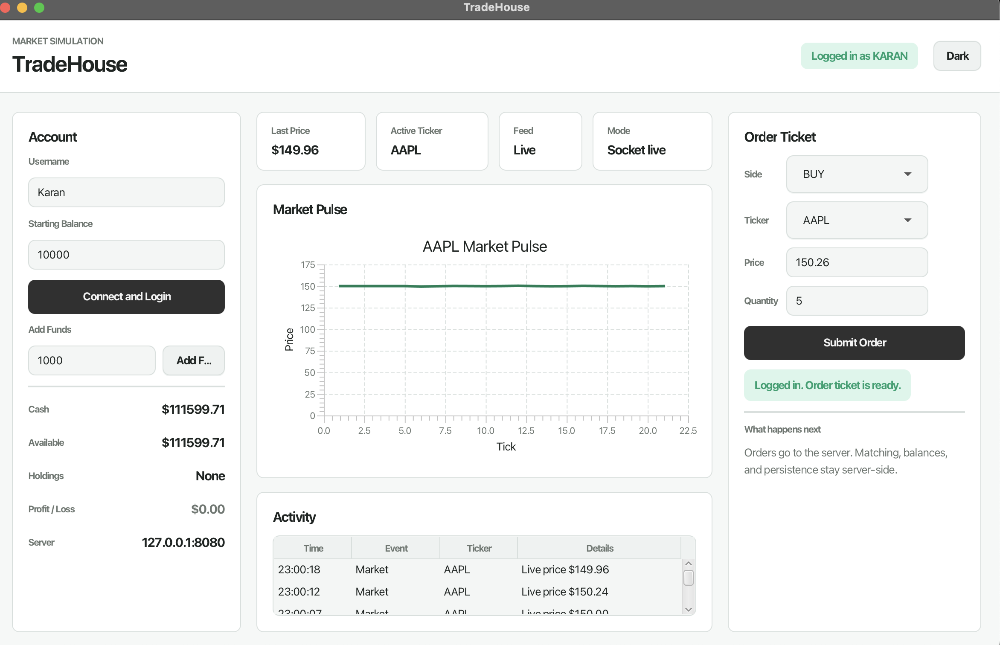
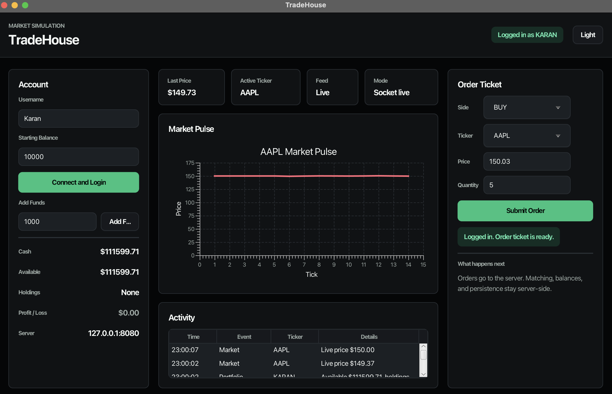

# TradeHouse

TradeHouse is a multi-threaded Java market simulation where multiple socket clients log in, place buy/sell orders, watch live market updates, and keep server-owned account state through CSV persistence. The project is built around the course requirements: JavaFX GUI, socket networking, server-side threading, and File I/O instead of a database.

## Collaborators

- Rayan Khan
- Karan Bhaskar
- Mohammad Ali Jafari

## Screenshot

### Light Mode


### Dark Mode


## Demo Video Link

Youtube: https://youtu.be/nVShaXnkJr0


## Features

- Multi-client socket server on port `8080`
- Threaded client handlers and server-side market-maker bots
- Synchronized order book with partial fills and price-priority matching
- JavaFX trading dashboard with live charting, order ticket, account panel, activity table, dark/light theme toggle, app-menu volatility/volume controls, and About window
- Client socket reader thread that responds to heartbeat `PING` with `PONG`
- Server-driven account updates for cash, available cash, holdings, add-funds requests, and session profit/loss display
- CSV persistence for completed trades, account snapshots, and open orders
- Automated backend check for two-client trading, heartbeat, and persistence

## Requirements

- JDK 25
- Maven 3.9+

Maven downloads JavaFX through the OpenJFX dependency, so no manual JavaFX installation is required.

## Clone And Build

```bash
git clone git@github.com:OntarioTech-CS-program/w26-csci2020u-finalproject-w26-team55.git
cd w26-csci2020u-finalproject-w26-team55
mvn clean compile
```

## Run the Application

Terminal 1: start the socket server. It listens for clients on port `8080`. Market-maker bots are enabled by default, so prices move on their own.

```bash
mvn exec:java -Dexec.mainClass=server.Server
```

Terminal 2: start the JavaFX GUI.

```bash
mvn javafx:run
```

This is the normal way to run and use TradeHouse.

### Optional Developer Checks

These commands are for someone who wants to inspect the socket/backend behavior without relying on the GUI.

To make backend checks easier, start the server with bots turned off. The server still uses port `8080`; `--no-bots` only disables robot traders so prices change from submitted orders instead of background bot activity.

```bash
mvn exec:java -Dexec.mainClass=server.Server -Dexec.args=--no-bots
```

Run the simple text-only client:

```bash
mvn exec:java -Dexec.mainClass=client.TestClient
```

This client sends one buy order and one sell order for `AAPL` and prints the server messages. It is a quick socket check, not the main UI.

Run the fuller backend check in another terminal while the server is running with `--no-bots`:

```bash
mvn exec:java -Dexec.mainClass=client.IntegrationProbe
```

`IntegrationProbe` is a small Java program that acts like two socket clients. It logs in, adds funds, submits buy/sell orders, verifies the trade broadcast, responds to heartbeat `PING`/`PONG`, and confirms CSV persistence evidence for the ledger, accounts, and open orders.

## Protocol

Client to server:

- `LOGIN:USERNAME:STARTING_BALANCE`
- `BUY:TICKER:PRICE:QUANTITY`
- `SELL:TICKER:PRICE:QUANTITY`
- `USERNAME:BUY:TICKER:PRICE:QUANTITY`
- `USERNAME:SELL:TICKER:PRICE:QUANTITY`
- `ADD_FUNDS:AMOUNT`
- `VOLATILITY:NORMAL`
- `VOLATILITY:WILD`
- `PONG`

Server to client:

- `CONNECTION_SUCCESS:...`
- `LOGIN_SUCCESS:USERNAME:CASH`
- `ACCOUNT_UPDATE:USERNAME:CASH:AVAILABLE_CASH:HOLDINGS`
- `SERVER_ACK:...`
- `SERVER_ERROR:...`
- `MARKET_UPDATE:TICKER:PRICE`
- `FUNDS_ADDED:USERNAME:AMOUNT`
- `VOLATILITY_UPDATE:MODE`
- `PING`
- `PONG`

## Persistence

Runtime CSV files are created under `data/`:

- `data/ledger.csv`: completed trades
- `data/accounts.csv`: account balances and holdings
- `data/open_orders.csv`: open buy/sell orders

On startup, the server restores accounts, open orders, and last known market prices from those files. Runtime CSV files are ignored by Git so local data does not pollute commits.

## Project Structure

- `src/main/java/server/`: server, client handlers, order book, bots, persistence, heartbeat logic
- `src/main/java/shared/`: shared `Order` model
- `src/main/java/client/`: console validation clients and `IntegrationProbe`
- `src/main/java/client/gui/`: JavaFX GUI, socket client, and audio cues
- `src/main/resources/client/gui/`: JavaFX CSS theme
- `data/`: runtime CSV persistence directory   

## References And Resources

- Java Standard Library: `java.net.Socket`, `java.util.concurrent`, `java.nio.file`, and `javax.sound.sampled`
- JavaFX Controls and `LineChart` via OpenJFX
- OpenJFX Maven plugin for `mvn javafx:run`
- Maven compiler and exec plugins

## AI Usage Disclosure

AI was used as assistance, not as a replacement for the team's work. It helped with UI color/theme ideas, JavaFX/CSS layout suggestions, About-window wording, README/rubric checklist planning, and debugging specific integration issues. The core socket architecture, multi-threading flow, order-book behavior, and persistence approach remain team-owned, and the final code was reviewed, adjusted, and tested by the team.
